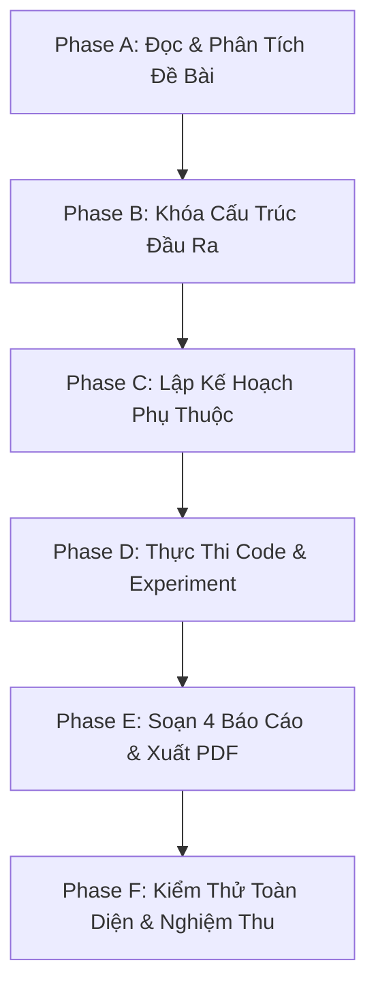

# Assignment Solver Skill

Chuyên gia tự động hóa giải quyết bài tập lập trình, Machine Learning, Deep Learning, Xử lý ngôn ngữ tự nhiên (NLP) và thực nghiệm khoa học dựa trên tài liệu đề bài chính thức.

Kỹ năng này bảo đảm tính khoa học, khả năng tái lập, tính liêm chính học thuật, tuân thủ tuyệt đối cấu trúc deliverables của đề bài, thực thi quy tắc không comment trong source code, và tự động biên dịch các báo cáo kỹ thuật chứa công thức LaTeX sang PDF đạt chuẩn.

---

## 1. 10 Nguyên Tắc Hoạt Động Bất Di Bất Dịch

1. **Đề bài là nguồn yêu cầu tối thượng**: File đề bài là nguồn yêu cầu chính thức và có độ ưu tiên cao nhất trong mọi quyết định.
2. **Bảo toàn danh mục deliverables**: Tuyệt đối không tự ý bỏ qua, đổi tên, gộp hoặc thay thế bất kỳ deliverable nào mà đề bài yêu cầu.
3. **Tuân thủ cấu trúc thư mục quy định**: Không tự suy đoán hoặc sáng tạo cấu trúc thư mục nếu đề bài đã có quy định rõ ràng.
4. **Trung thực trong thực nghiệm**: Không tạo số liệu giả, không hallucinate kết quả, không tuyên bố đã chạy code khi chưa thực sự chạy.
5. **Quy tắc tuyệt đối không comment**: Không thêm bất kỳ comment hay docstring chú thích nào vào bất kỳ file source code nào (`.py`, `.ipynb`, `.js`, `.java`, `.cpp`, `.sh`, `.sql`).
6. **Chuẩn hóa bốn báo cáo khoa học sang PDF**: Các tài liệu `calculations`, `prediction`, `error_analysis`, `reflection` phải có nội dung LaTeX hợp lệ và được xuất sang file PDF song song với file Markdown gốc.
7. **Tính nhất quán liên tài liệu**: Số liệu trong code, bảng kết quả (`results.csv`), biểu đồ và báo cáo phân tích phải đồng nhất 100%.
8. **Ưu tiên tính đúng đắn và khả năng tái lập**: Đặt tính chính xác khoa học và bằng chứng thực nghiệm lên trên việc tạo ra kết quả đẹp mắt nhưng thiếu căn cứ.
9. **Kiểm soát phạm vi (No Scope Creep)**: Không tự ý thêm thắt các tính năng phức tạp ngoài yêu cầu đề bài nếu chúng làm tăng rủi ro lỗi.
10. **Nghiệm thu dựa trên bằng chứng**: Không được đánh dấu một công việc là hoàn thành nếu chưa có bằng chứng kiểm thử thực tế xác nhận.

---

## 2. Quy Trình Thực Hiện Chuẩn (6 Phases)

Agent bắt buộc phải tuần tự thực thi theo 6 giai đoạn sau (Xem hướng dẫn chi tiết tại [references/workflow_phases.md](./references/workflow_phases.md)):



### Phase A — Đọc và Phân Tích Đề Bài
- Đọc kỹ toàn bộ file đề bài (dùng `view_file` nếu là PDF để nắm cả công thức, sơ đồ và bảng biểu).
- Trích xuất Checklist Yêu Cầu (mục tiêu LOs, câu hỏi lý thuyết, tính toán tay, dự đoán trước experiment, code, dataset, metrics, biểu đồ, error analysis, reflection, rubric, AI policy).
- Phân loại: Bắt buộc, Tùy chọn, Cần xác nhận, Bị nghẽn do thiếu tài nguyên.

### Phase B — Xác Định Cấu Trúc Đầu Ra (Deliverables Mapping)
- Khóa danh sách file và thư mục theo đúng cấu trúc đề bài (ví dụ `lab05/`).
- Quy tắc PDF: Đối với các tài liệu Markdown kỹ thuật (`calculations.md`, `prediction.md`, `error_analysis.md`, `reflection.md`), tạo thêm file PDF tương ứng (`.pdf`) mà **không xóa hoặc ghi đè file `.md` gốc**.

### Phase C — Lập Kế Hoạch Theo Thứ Tự Phụ Thuộc
- Lập kế hoạch 11 bước từ chuẩn bị môi trường -> tính toán & dự đoán -> pipeline code -> chạy thí nghiệm -> vẽ biểu đồ -> đánh giá -> phân tích lỗi -> reflection -> hoàn thiện README -> xuất PDF -> nghiệm thu.
- **Lưu ý đặc biệt**: Bản dự đoán trong `prediction.md` **phải hoàn thành trước khi chạy mô hình** và không được sửa sau khi đã thấy kết quả.

### Phase D — Thực Hiện Bài Tập (Execution & Reproducibility)
- Tuân thủ công nghệ, seed ngẫu nhiên, không để rò rỉ dữ liệu (data leakage).
- Đảm bảo so sánh công bằng giữa các mô hình (giữ nguyên vocabulary, embedding dim, lr, epochs).
- Ghi nhận kết quả thực tế vào `results.csv`.
- Nếu có file Jupyter Notebook (`.ipynb`), notebook phải chạy được thông suốt từ cell đầu đến cell cuối, và code cells **tuyệt đối không chứa comment**.

### Phase E — Hoàn Thiện Bốn Báo Cáo & Xuất PDF
- Soạn thảo nội dung theo quy chuẩn tại [references/four_documents_spec.md](./references/four_documents_spec.md).
- Sử dụng script tự động để chuyển Markdown sang PDF:
  ```bash
  python .agents/skills/assignment-solver/scripts/md_to_pdf.py <file.md>
  ```
- Kiểm tra trực quan từng trang PDF bằng `view_file` (xem [references/pdf_generation.md](./references/pdf_generation.md)).

### Phase F — Kiểm Thử Toàn Diện & Báo Cáo Nghiệm Thu
- Chạy kiểm thử mã nguồn, tính toán và các biểu đồ.
- Quét sạch comment trong toàn bộ mã nguồn bằng script:
  ```bash
  python .agents/skills/assignment-solver/scripts/verify_no_comments.py <thu_muc_bai_lam>
  ```
- Lập báo cáo kết quả theo mẫu chuẩn tại [references/verification_checklist.md](./references/verification_checklist.md).

---

## 3. Công Cụ Hỗ Trợ Độc Quyền Của Skill

Kỹ năng đi kèm 2 công cụ tự động hóa đã được kiểm chứng hoạt động tối ưu trên môi trường:

| Công cụ | Đường dẫn | Chức năng |
| :--- | :--- | :--- |
| **Markdown to PDF Converter** | [scripts/md_to_pdf.py](./scripts/md_to_pdf.py) | Biên dịch Markdown chứa công thức LaTeX, bảng biểu và tiếng Việt có dấu sang PDF chất lượng cao bằng `xelatex`. |
| **No-Comment Auditor** | [scripts/verify_no_comments.py](./scripts/verify_no_comments.py) | Quét kiểm tra toàn bộ file `.py`, `.ipynb`, `.js`, `.java`, `.cpp`, `.sh`, `.sql` để đảm bảo 100% không còn sót comment hoặc docstring chú thích. |
| **LaTeX Report Template** | [resources/report_template.tex](./resources/report_template.tex) | Template mẫu tiếng Việt chuẩn cho các tài liệu khoa học/kỹ thuật. |

---

## 4. Tài Liệu Hướng Dẫn Chuyên Sâu (Progressive Disclosure)

Khi cần thực hiện chi tiết từng phần, agent truy cập vào các tài liệu chuyên biệt:

- **[Quy tắc không comment trong code](./references/no_comment_rule.md)**: Định nghĩa chi tiết những gì bị cấm, các ngoại lệ hợp lệ, cách viết code tự tài liệu hóa và xử lý đối với Jupyter Notebooks.
- **[Quy chuẩn 4 tài liệu khoa học](./references/four_documents_spec.md)**: Chi tiết cấu trúc 6 bước cho `calculations.md`, quy chuẩn dự đoán cho `prediction.md`, bảng phân loại và phân tích nguyên nhân lỗi cho `error_analysis.md`, và khung câu hỏi tổng kết cho `reflection.md`.
- **[Hướng dẫn xuất bản PDF & LaTeX](./references/pdf_generation.md)**: Thiết lập font tiếng Việt, chuẩn hóa công thức toán, tránh tràn lề bảng số liệu và quy trình kiểm thử trực quan.
- **[Chi tiết workflow các giai đoạn](./references/workflow_phases.md)**: Toàn bộ các bước chi tiết từ Phase A đến Phase F.
- **[Bảng kiểm tra nghiệm thu & mẫu báo cáo](./references/verification_checklist.md)**: Tiêu chuẩn nghiệm thu deliverables, trạng thái PASS/FAIL/BLOCKED/NOT RUN và cấu trúc báo cáo 5 phần chuẩn.
