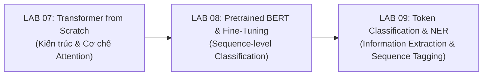

# LAB 08 — BÁO CÁO CHIÊM NGHIỆM VÀ ĐỊNH HƯỚNG PHÁT TRIỂN (REFLECTION)
## Pretrained Transformers and BERT Fine-Tuning

**Môn học**: Xử lý ngôn ngữ tự nhiên và ứng dụng  
**Học kỳ**: Học kỳ I - 2026  
**Sinh viên thực hiện**: Nguyễn Văn Thành  
**Mã bài tập**: LAB 08  

---

## 1. Bài Luận Chiêm Nghiệm: Vì Sao Trong Thực Tế Không Huấn Luyện Transformer Từ Đầu?

*(Quy mô: ~450 từ — Phản ánh đầy đủ 6 trụ cột cốt lõi theo Mục 29 trong Đề bài)*

Sau khi hoàn thành LAB 07, chúng ta đã nắm vững tường minh cách xây dựng một khối Transformer hoàn chỉnh từ các tầng toán học cơ bản: Multi-Head Self-Attention, Positional Encoding, kết nối tắt Residual, Layer Normalization và Feed-Forward Network. Về mặt lý thuyết, một kỹ sư hoàn toàn có thể khởi tạo các trọng số $\theta \sim \mathcal{N}(0, \sigma^2)$ và tiến hành huấn luyện trực tiếp trên tập dữ liệu bài toán mục tiêu. Tuy nhiên, qua các thực nghiệm đo đạc định lượng tại LAB 08, câu trả lời đã được khẳng định dứt khoát: **Trong thực tế công nghiệp và nghiên cứu hiện đại, người ta gần như không bao giờ bắt đầu bằng việc huấn luyện một Transformer từ đầu (from scratch) cho các tác vụ NLP.**

Lý do thứ nhất bắt nguồn từ **rào cản dữ liệu (Data)**. Kiến trúc Transformer vốn không có sẵn các giả thiết tiên nghiệm (inductive bias) mạnh mẽ như tính cục bộ của CNN hay tính liên tục thời gian của RNN. Do đó, để học được các quy luật cú pháp và cấu trúc ngữ nghĩa cơ bản, Transformer có "cơn khát dữ liệu" khổng lồ, đòi hỏi hàng chục đến hàng trăm triệu câu văn bản. Đa phần các bài toán thực tế (downstream tasks) trong doanh nghiệp chỉ có vài trăm đến vài chục nghìn mẫu có gắn nhãn. Nếu huấn luyện from-scratch trên tập dữ liệu nhỏ này, mô hình nhanh chóng rơi vào hiện tượng quá khớp (overfitting) thảm khốc và tê liệt năng lực khái quát hóa.

Lý do thứ hai nằm ở **giá trị vô giá của biểu diễn tiền huấn luyện (Pretrained Representation)**. Thông qua mục tiêu tự giám sát (self-supervised) như Masked Language Modeling (MLM), mô hình (tiêu biểu là BERT) đã được hấp thụ tri thức ngôn ngữ từ hàng tỷ từ vựng trên Wikipedia và BookCorpus. Biểu diễn tiềm ẩn của token `[CLS]` và các tầng ẩn trên cùng đã gói trọn cấu trúc ngữ pháp sâu sắc, quan hệ từ vựng và tri thức thế giới nền tảng.

Lý do thứ ba là **chi phí tính toán và tài nguyên (Computational Cost)**. Việc tiền huấn luyện một mô hình nền tảng đòi hỏi cụm siêu máy tính với hàng trăm GPU/TPU chạy liên tục trong nhiều tuần, tiêu tốn hàng trăm nghìn USD và phát thải carbon lớn. Ngược lại, kỹ thuật **Fine-Tuning** hoặc **Feature Extraction (Frozen Encoder)** cho phép tận dụng điểm khởi đầu tối ưu $\theta_{\text{pretrained}}$ để thích nghi mô hình vào bài toán đích chỉ trong vài phút đến vài giờ trên một máy tính cá nhân hoặc GPU phổ thông với chi phí tối thiểu.

Tuy nhiên, bài học thực tế từ LAB 08 cũng nhấn mạnh **những giới hạn cố hữu (Limitations & Domain Shift)**. Mô hình tiền huấn luyện không phải là một chiếc chìa khóa vạn năng: Hiện tượng lệch miền (Domain Shift) xảy ra rõ rệt khi phân phối từ vựng và văn phong thay đổi; độ phức tạp bộ nhớ bậc hai $\mathcal{O}(T^2)$ giới hạn độ dài chuỗi xử lý; nguy cơ quên thảm khốc (catastrophic forgetting) và hiện tượng tự tin thái quá giả tạo ($\text{confidence} \ne \text{correctness}$) vẫn tồn tại. Việc hiểu rõ ranh giới này giúp người làm NLP lựa chọn chiến lược phù hợp: đóng băng encoder khi dữ liệu ít, fine-tuning cẩn trọng với learning rate nhỏ ($2\times 10^{-5}$) khi dữ liệu dồi dào, và luôn thực hiện kiểm chuẩn lỗi khắt khe.

---

## 2. Bảng Trả Lời 12 Câu Hỏi Kiểm Tra Nhận Thức Cá Nhân (Individual Learning Check)

*(Theo Mục 27 trong file đề bài W8.pdf)*

| STT | Câu hỏi kiểm tra | Trả lời khoa học súc tích bằng ngôn ngữ cá nhân |
| :---: | :--- | :--- |
| **1** | **Pretraining khác fine-tuning ở đâu?** | Pretraining là quá trình huấn luyện tự giám sát trên kho ngữ liệu khổng lồ không nhãn để học biểu diễn ngôn ngữ tổng quát; Fine-tuning là giai đoạn tiếp tục huấn luyện mô hình đã có trọng số đó trên tập dữ liệu có nhãn nhỏ của bài toán cụ thể. |
| **2** | **MLM là gì?** | Masked Language Modeling là mục tiêu tự giám sát trong đó một tỷ lệ token trong câu (thường $15\%$) bị che ngẫu nhiên bằng token `[MASK]`, buộc mô hình phải dựa vào ngữ cảnh hai chiều xung quanh để dự đoán token gốc. |
| **3** | **Tại sao cần tokenizer?** | Máy tính chỉ có thể tính toán với các ma trận số học. Tokenizer đóng vai trò cầu nối chuyển đổi chuỗi ký tự văn bản thô thành các chỉ số số nguyên rời rạc (Token IDs) để tra cứu bảng Embedding. |
| **4** | **Subword token giải quyết vấn đề gì?** | Giải quyết vấn đề Out-Of-Vocabulary (OOV) và bùng nổ kích thước từ điển bằng cách phân rã các từ hiếm hoặc từ mới thành các đơn vị con phổ biến (ví dụ: *"unbelievable"* $\to$ *"un"*, *"##belie"*, *"##vable"*). |
| **5** | **`[CLS]` thường được sử dụng như thế nào?** | Được đặt ở đầu chuỗi đầu vào; qua các tầng Self-Attention, trạng thái ẩn của `[CLS]` tại tầng cuối cùng tích lũy thông tin toàn cục của toàn bộ câu và được dùng làm vector đầu vào cho classification head. |
| **6** | **Attention mask dùng để làm gì?** | Để báo cho cơ chế chú ý biết vị trí nào là token văn bản thật ($1$) và vị trí nào là padding nhân tạo ($0$). Vị trí mang giá trị $0$ sẽ bị gán điểm âm vô cùng ($-\infty$) trước Softmax để không ảnh hưởng đến ngữ cảnh. |
| **7** | **Frozen encoder nghĩa là gì?** | Là việc cố định toàn bộ các tham số trọng số của bộ mã hóa Transformer (`requires_grad = False`), không cập nhật chúng qua lan truyền ngược mà chỉ huấn luyện các tham số của tầng phân loại ở đỉnh. |
| **8** | **Fine-tuning thay đổi những tham số nào?** | Trong Full Fine-Tuning, toàn bộ tham số của mô hình bao gồm ma trận trọng số trong các tầng Attention, FFN, LayerNorm của Encoder và các tham số của Classification Head đều được cập nhật gradient. |
| **9** | **Vì sao pretrained model có thể hữu ích khi downstream dataset nhỏ?** | Vì mô hình đã sở hữu sẵn nền tảng ngữ pháp và ngữ nghĩa từ trước; bài toán downstream chỉ cần học cách căn chỉnh ranh giới phân loại đơn giản chứ không phải học biểu diễn ngôn ngữ từ số không. |
| **10** | **Pretrained model có đảm bảo không bị domain shift không?** | Hoàn toàn không. Nếu miền dữ liệu downstream có phân phối từ vựng, tiếng lóng, phong cách hoặc ngữ cảnh khác xa kho văn bản tiền huấn luyện, mô hình vẫn bị suy giảm hiệu năng nghiêm trọng. |
| **11** | **Vì sao tăng sequence length làm chi phí attention tăng?** | Vì cơ chế Self-Attention tính toán ma trận tương tác giữa mọi cặp token trong câu, dẫn đến kích thước ma trận $T \times T$ và độ phức tạp tính toán/bộ nhớ tăng theo hàm bậc hai $\mathcal{O}(T^2)$. |
| **12** | **Confidence cao có đảm bảo prediction đúng không?** | Không. Mô hình Deep Learning thường bị miscalibration; hiện tượng thiên lệch từ vựng bề mặt có thể khiến hàm Softmax xuất ra xác suất trên $80\%$ cho một dự đoán hoàn toàn sai lầm. |

---

## 3. Mạch Nối Sang LAB 09 (Bridge to LAB 09)

Mạch kiến thức xuyên suốt từ LAB 07 qua LAB 08 và chuẩn bị bước sang LAB 09:

- **Từ Cấp Độ Chuỗi (Sequence-Level) sang Cấp Độ Token (Token-Level)**:  
  Tại LAB 08, bài toán phân loại cảm xúc chỉ đòi hỏi một nhãn duy nhất cho toàn bộ chuỗi văn bản thông qua vector đại diện `[CLS]`:
  $$\mathbf{h}_{\text{[CLS]}} \in \mathbb{R}^d \xrightarrow{\text{Linear}} y \in \{\text{Negative}, \text{Positive}\}$$
  Tuy nhiên, trong xử lý ngôn ngữ thực tế, chúng ta thường cần trích xuất thông tin chi tiết bên trong câu: từ nào đại diện cho tên người (PERSON), địa danh (LOCATION), tổ chức (ORGANIZATION) hay thực thể y sinh:
  $$\text{"Barack Obama"} \xrightarrow{\text{Token Classification}} \text{PERSON}, \quad \text{"Paris"} \xrightarrow{\text{Token Classification}} \text{LOCATION}$$
- **Khai Thác Chiều Sâu Của Pretrained Transformer**:  
  Sang LAB 09, thay vì chỉ lấy một vector đơn lẻ tại chỉ số $0$, chúng ta sẽ sử dụng toàn bộ chuỗi trạng thái ẩn Contextual Embeddings:
  $$\mathbf{H} = [\mathbf{h}_0, \mathbf{h}_1, \dots, \mathbf{h}_T] \in \mathbb{R}^{T \times d}$$
  và áp dụng tầng phân loại trên từng vị trí token độc lập kèm theo sơ đồ gán nhãn BIO (Beginning, Inside, Outside). Đây chính là bước chuyển hóa tự nhiên từ phân loại văn bản sang bài toán **Named Entity Recognition (NER)** và **Information Extraction**.
